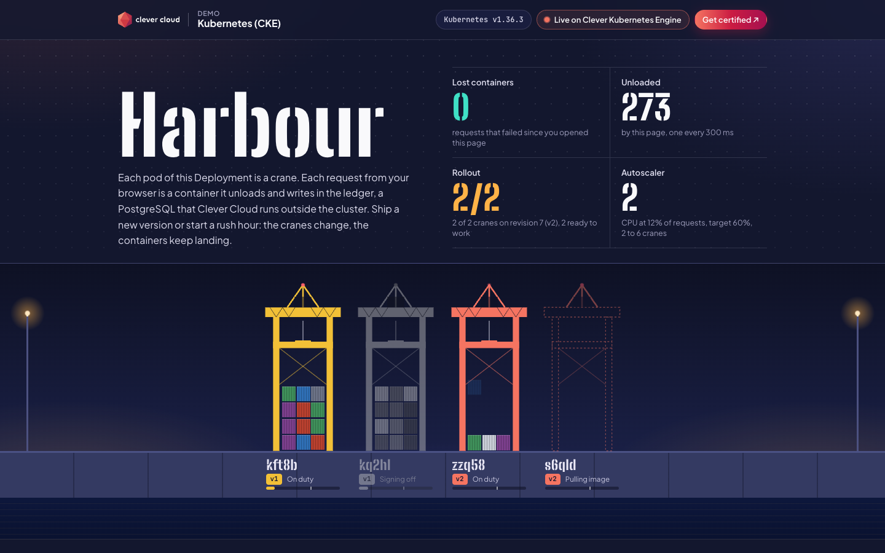
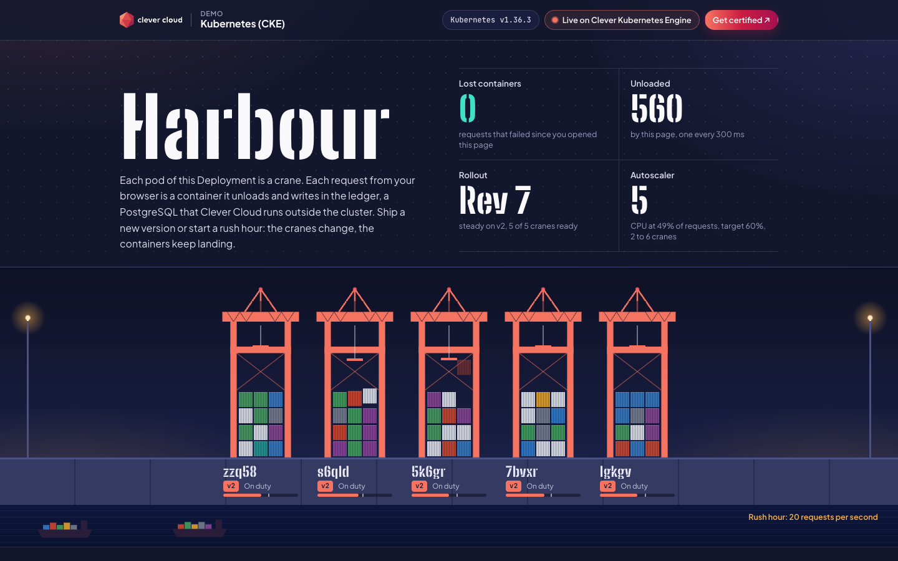
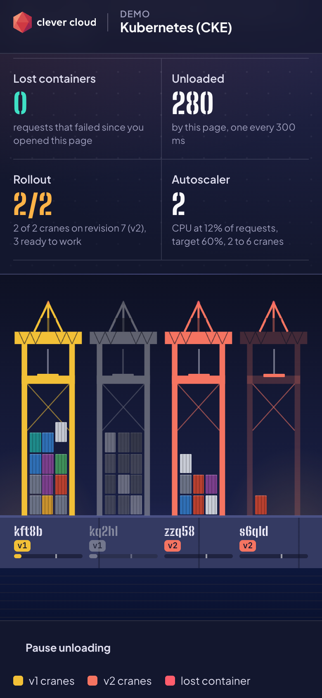
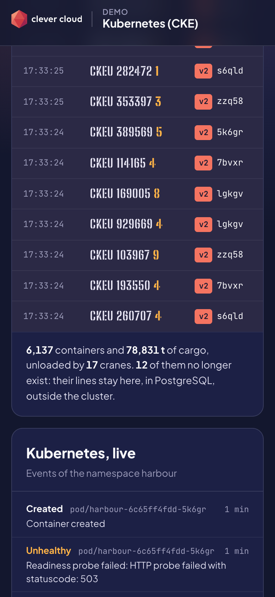

# Harbour — Kubernetes (CKE) on Clever Cloud

> A container port at night. Every pod of the team's own Go service is a crane; every request from your browser is a container it unloads and writes in the ledger, a PostgreSQL that Clever Cloud runs **outside the cluster**. Ship version 2 and the cranes are repainted one by one while the **lost containers** counter stays at zero. Start a rush hour and the **HorizontalPodAutoscaler** opens new cranes, then closes them. Push a broken release and it never gets a single request. The page reads all of it from the Kubernetes API with its own read-only ServiceAccount: pods, rollout, autoscaler, events. Plain manifests and `kubectl`, on a control plane that Clever Cloud runs in France.





| Phone, during the rolling update | Phone, the ledger and the Kubernetes events |
|---|---|
|  |  |

**Run it yourself.** The hosted demo was taken down after the presales review (November 2026). The steps in [Deploy on Clever Cloud](#deploy-on-clever-cloud) recreate it from scratch in about 15 minutes.

## What Kubernetes and Clever Cloud do here

| Where | Feature | What you see |
|---|---|---|
| The quay | A `Deployment` of the team's image, one pod per crane. The page reads pods, the Deployment, the HPA, events and pod metrics through a namespaced, read-only `Role` (no access to Secrets) | Cranes appear, pull their image, go on duty, sign off. Each plate shows the pod name, its version and its CPU against its request |
| Ship version 2 | `RollingUpdate` with `maxSurge: 1` and `maxUnavailable: 0`, a readiness probe that waits for the database, `preStop: sleep: 5` (native, no shell in the image), graceful shutdown on `SIGTERM` | Yellow v1 cranes are replaced by coral v2 cranes one at a time. **Lost containers** stays at 0 |
| Rush hour | `HorizontalPodAutoscaler` on CPU (target 60 %, 2 to 6 pods), with the metrics-server that CKE installs. The load is a `Job` running the same image (`harbour rush`) | CPU bars fill, new cranes rise, ships queue in the basin. The cranes leave a minute after the rush |
| A bad release | Readiness gate, `progressDeadlineSeconds: 90`, `kubectl rollout undo` | The new crane stays *Not ready* and gets no traffic; the rollout is marked *Stalled*; the old cranes keep working |
| The ledger | Clever Cloud PostgreSQL add-on (`xxs_sml`, created with encryption at rest). Its variables reach the pods through a `Secret` with the add-on's own names (`POSTGRESQL_ADDON_URI`…) | Each line names the crane that wrote it. The summary counts the cranes that no longer exist: their lines are still there |
| The address | `Service` of type `LoadBalancer`: CKE gives it an L4 load balancer with two public IPs | `http://<external-ip>/` |

### Measured on 2026-11-04 (CKE public beta, Kubernetes v1.36.3)

- **Rolling updates under traffic.** A `curl` probe (a new connection per request, each one a database write) ran across each rollout, next to an open page:

  | Rollout | Probe | Page |
  |---|---|---|
  | v1 → v2 | 290 requests, 290 answered 200: 199 by v1, then 91 by v2, both versions side by side for 8 s | 262 containers, 0 lost |
  | v1 → v2 again, final images | 255 requests, 255 answered 200 | 338 containers, 0 lost |
  | `kubectl rollout restart` (5 pods replaced in 27 s) | 106 requests, 106 answered 200 | – |
  | A bad release, then `rollout undo` | 478 requests, 478 answered 200, all by the old pods | *Stalled* shown, 0 lost |

- **Rush hour.** At 30 requests per second: 7,200 sent, 0 failed; the HPA saw 174 % CPU and went from 2 to 6 pods in one step, then back to 4 and 2 within a minute and a half after the rush. At 20 requests per second (the manifest as shipped): 4,800 sent, 0 failed, 2 to 5 pods.
- **The ledger.** After all this, 7,574 lines written by 22 different pods. Only 5 of those pods were still running.
- **Cluster.** `clever k8s create` reached `ACTIVE` in about a minute. Each pod used 5 to 14 MiB of memory.

## What CKE gives you (checked, not assumed)

- **A managed control plane.** `clever k8s create harbour` with no other option gives the `ALL_IN_ONE` topology, flavor `S`, replication factor 1: one VM with 8 vCPU and 12 GB that runs the control plane and your pods. The price list of the [CKE documentation](https://www.clever.cloud/developers/doc/deploy/kubernetes/#pricing) gives 0.0889 € per hour for it during the beta.
- **Vanilla Kubernetes:** v1.36.3, Cilium as the network layer, amd64 nodes, `kubectl` and any manifest work as they are.
- **metrics-server is installed**, so `kubectl top` and the HorizontalPodAutoscaler work right away.
- **`LoadBalancer` Services get two public IPs** (L4, TCP). The default quota is one such Service per organisation.
- **No ingress controller and no Gateway API** are installed (no `IngressClass`, no Gateway CRDs). This demo is served in plain HTTP on the load balancer IPs. HTTPS on your own domain means installing an ingress or Gateway controller and cert-manager behind that load balancer: not done here.
- **Public beta.** The feature is turned on per user with `clever features enable k8s`; clusters are managed with `clever k8s` (clever-tools 4.9 or later). The [Clever Kubernetes Operator](https://www.clever.cloud/developers/doc/deploy/kubernetes/operator/) can also create add-ons from custom resources; it is not used here because it needs a Clever Cloud API token inside the cluster.

## Deploy on Clever Cloud

You need [clever-tools](https://www.clever.cloud/developers/doc/cli/) with the Kubernetes feature on (`clever features enable k8s`), `kubectl`, [ko](https://ko.build) (`brew install ko`, builds the Go image without Docker), `jq`, and the ID of the organisation that will own the resources (`orga_…`). Run the commands from the repo root.

```bash
export ORG=<org_id>

# 1. A managed Kubernetes cluster: ALL_IN_ONE, flavor S, one VM. ACTIVE in about a minute.
clever k8s create harbour --org $ORG --watch --yes
clever k8s get-kubeconfig harbour --org $ORG > harbour.kubeconfig   # private: never print it
export KUBECONFIG=$PWD/harbour.kubeconfig
kubectl get nodes

# 2. The ledger: a managed PostgreSQL, encrypted at rest. Note the add-on ID it prints (addon_…).
clever addon create postgresql-addon harbour-ledger --plan xxs_sml --region par --org $ORG --option encryption=true --yes

# 3. Its credentials as a Kubernetes Secret. Nothing is printed.
kubectl apply -f k8s/00-namespace.yaml
bin/db-secret.sh <addon_id>

# 4. Build the team's image, push it, deploy it.
export KO_DOCKER_REPO=ttl.sh/harbour-$(openssl rand -hex 6)   # or your registry: ghcr.io/<team>/harbour
VERSION=v1 ko apply --bare -t v1 -f k8s/
kubectl -n harbour get service harbour   # open http://<EXTERNAL-IP>/
```

[ttl.sh](https://ttl.sh) is an anonymous registry that deletes images after 24 hours: fine for a demo, not for anything that lasts. CKE pulls from any OCI registry; for a private one, add an `imagePullSecrets` as the [CKE documentation](https://www.clever.cloud/developers/doc/deploy/kubernetes/#pull-images-from-authenticated-registries) shows.

**Before an audience, push version 2 in advance.** A first push to ttl.sh took about 3.5 minutes. ko rebuilds the same binary bit for bit, so a later `ko apply` of a version already pushed only has to check the registry: that took 6 seconds once, and up to 3.5 minutes on another try with ttl.sh. For a live demo, push both versions beforehand to your team's registry:

```bash
VERSION=v2 ko build --bare -t v2 .
```

## The show

Keep the page open on a big screen; each act is one command, and each one is also written on the page.

1. **Ship version 2.** `VERSION=v2 ko apply --bare -t v2 -f k8s/`. One new crane at a time; each old crane leaves only when a new one is ready. *Lost containers* stays at 0.
2. **Rush hour.** `VERSION=v2 ko apply --bare -f k8s/rush-hour/`. 20 requests per second for 4 minutes on `/api/work` (about 10 ms of CPU each). The HPA adds cranes within a minute and removes them a minute after the rush. To run it again within two minutes: `kubectl -n harbour delete job rush-hour` first.
3. **A bad release.** `kubectl -n harbour set env deployment/harbour POSTGRESQL_ADDON_URI=postgres://nowhere:5432/x`. The new crane cannot reach the ledger, stays *Not ready* and receives nothing; after 90 seconds the rollout is *Stalled*. Your users never saw it.
4. **Roll back.** `kubectl -n harbour rollout undo deployment/harbour`.
5. **The data outlives the pods.** `kubectl -n harbour rollout restart deployment/harbour` replaces every crane; the ledger keeps every line and counts the cranes that are gone.

## Clean up

```bash
clever k8s delete harbour --org $ORG          # asks for confirmation
clever addon delete harbour-ledger --org $ORG # asks for confirmation
rm harbour.kubeconfig
```

## Variables

| Variable | Set by | Role |
|---|---|---|
| `POSTGRESQL_ADDON_URI` | the Secret `harbour-db`, filled by `bin/db-secret.sh` from the add-on | The ledger connection. The Secret also carries `POSTGRESQL_ADDON_HOST`, `_PORT`, `_DB`, `_USER`, `_PASSWORD` and `_VERSION`: the names a Clever Cloud application gets, so the code is the same on both |
| `POD_NAME`, `POD_NAMESPACE`, `NODE_NAME` | the Deployment, through the Downward API | The crane's plate and the "Running on Clever Kubernetes Engine" panel |
| `VERSION` | you, at build time (`ko`, `-ldflags`) | `v1`, `v2`…: baked into the binary, shown on each crane |
| `KO_DOCKER_REPO` | you, at build time | The registry the image is pushed to |
| `PORT` | optional | Defaults to 8080 |

The "Running on Clever Kubernetes Engine" panel shows the pod, node, namespace, version, image digest and Go version, and nothing else.

## Routes

`/` the harbour · `POST /api/unload` one container, written to the ledger · `GET /api/ledger` last lines and totals · `GET /api/fleet` pods, Deployment, HPA, events and pod metrics from the Kubernetes API (cached one second) · `GET /api/whoami` · `GET /api/work` about 10 ms of CPU, for the rush hour · `/health` liveness, no add-on · `/health/ready` readiness: ledger migrated and not shutting down · `/health/deep` PostgreSQL now.

Every response carries `X-Harbour-Crane` (the pod) and `X-Harbour-Version`. API responses close the connection, so each call is balanced again by the Service and a pod that leaves keeps no client.

## Code tour

```
main.go           server, routes, readiness, graceful shutdown on SIGTERM
ledger.go         PostgreSQL: migration under an advisory lock, cargo seed, writes and reads
kube.go           a read-only Kubernetes API client: plain HTTPS and the ServiceAccount token
container.go      ISO 6346 container numbers, with their check digit
rush.go           the rush-hour load generator, in the same binary (harbour rush)
web/              the page: index.html, harbour.css, harbour.js; cc-brand.css is the Clever Brand Kit
k8s/              Namespace, RBAC, Deployment, Service, HPA, PodDisruptionBudget; rush-hour/ holds the Job
bin/db-secret.sh  add-on credentials to a Kubernetes Secret, applied server-side, never printed
.ko.yaml          the image: distroless, linux/amd64, VERSION baked in
main_test.go      go test ./...  (set TEST_DATABASE_URL to also test the ledger on a real PostgreSQL)
```

Go 1.27 and pgx v5. No web framework, no Kubernetes client library.

## Run locally

```bash
POSTGRESQL_ADDON_URI=postgres://localhost:5432/harbour PORT=8080 go run .
TEST_DATABASE_URL=postgres://localhost:5432/harbour go test ./...
```

Outside a cluster the page shows a single crane (your machine) and no Kubernetes data.

## Limits

- CKE is in public beta (November 2026). Load balancers and persistent storage are not billed yet; the documentation says they will be before general availability.
- Plain HTTP on IP addresses: no ingress controller is installed by default.
- Only pod autoscaling is shown. Node autoscaling (`clever k8s nodegroups update … --autoscaling --min --max`) exists but was not tested: this cluster is a single VM.
- Each open page adds about three lines per second to the ledger.

MIT License.
